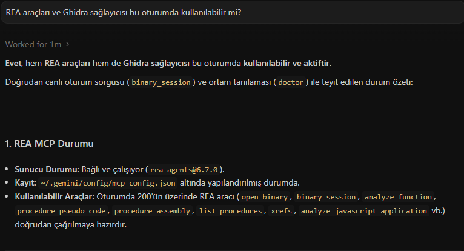
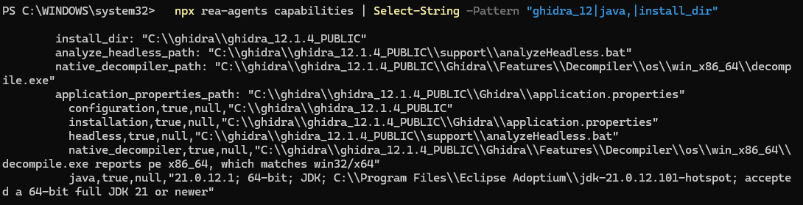

# gpower-clone: χ² olumsallık tablosu güç analizi (YZM301 Teardown Sprint, 7. grup, K4, bireysel çalışma)

**Yapılan katmanlar: temel katman (CLI) ve +15 MCP sunucusu.** AI ajanı bonus katmanı yapılmadı.

> **Bu yazılım G*Power değildir.** G*Power'ın yazarlarıyla ya da dağıtımıyla ilgisi yoktur ve onun yerine geçmez. G*Power yalnızca davranışını gözlemlediğimiz bir referans (kâhin) olarak kullanıldı. Komutun adı (`gpower-clone`) ders sözleşmesi (CONTRACT.md) tarafından zorunlu tutulduğu için böyledir. Hesap, yayımlanmış yöntemlerden ve gözlenen davranıştan bağımsız olarak yeniden yazıldı. Repoda G*Power'ın çalıştırılabilir dosyası ya da decompile çıktısı yoktur.

Bu çalışma, G*Power'ı ücretsiz sunan yazarların emeğine saygıyla, yalnızca eğitim amacıyla yapılmıştır.

## Atıf

- Faul, F., Erdfelder, E., Lang, A.-G., & Buchner, A. (2007). G*Power 3: A flexible statistical power analysis program for the social, behavioral, and biomedical sciences. *Behavior Research Methods, 39*, 175–191.
- Faul, F., Erdfelder, E., Buchner, A., & Lang, A.-G. (2009). Statistical power analyses using G*Power 3.1: Tests for correlation and regression analyses. *Behavior Research Methods, 41*, 1149–1160.

## Yazar

[RAVZANUR ERDOĞAN], bireysel çalışma · 7. grup · Konu: K4, χ² testi, olumsallık tablosu · Ders: YZM301

## Kapsam

- Test: `chi2-contingency` (G*Power: χ² tests, Goodness-of-fit tests: Contingency tables)
- Modlar: `a-priori` (N hesapla), `post-hoc` (güç hesapla)
- Uygulanmadı: `compromise`, `criterion`, `sensitivity` (bonus modlar, `UNSUPPORTED` döner)

## Kurulum ve çalıştırma

Gereksinimler: Python 3.13 (sınanan sürüm). **Motor yalnızca standart kütüphaneyi kullanır** (`math`, `re`, `decimal`); merkezi ve merkezsiz χ² dağılımı kendi kodumuzla uygulandı, numpy/scipy yüklenmez. scipy ve statsmodels yalnızca testlerde bağımsız kâhin olarak kullanılır.

```
python src/gpower-clone --test chi2-contingency --mode a-priori --w 0.3 --alpha 0.05 --power 0.95 --df 5
```

Beklenen çıktı (tek satır JSON):

```
{"ncp": 19.8, "critical_chi2": 11.0704977..., "n_total": 220, "actual_power": 0.9502155...}
```

Sürüm: `python src/gpower-clone --version`

## Testler

```
pip install -r src/requirements.txt pytest statsmodels
$env:PYTHONPATH="src"   # PowerShell. cmd.exe icin: $env:PYTHONPATH="src"   # PowerShell. cmd.exe icin: set PYTHONPATH=src
python -m pytest tests -q
python tests/run_differential.py --cmd "python src/gpower-clone" --n-random 500 --wide 300
```

Sonuçlar (ayrıntı: `tests/uyum_raporu.md`):

| Test | Sonuç |
|---|---|
| pytest (SPEC.md'den türetilen testler ve matematik karşılaştırması) | 287/287 geçti |
| Oracle (G*Power arayüzünden okunan 50 vektör, sınır ve hata dahil) | 50/50 tam eşleşme |
| statsmodels ile bağımsız 500 rastgele vektör (N = yukarı yuvarlanmış kesirli N) | 500/500 tam eşleşme |
| scipy ile 300 uç değerli vektör (alpha 1e-7..0.5, df ..500, w 0.001..2) | 298 tam eşleşme, 1 uyarı, 1 fark (iki satır da N ≥ 7e7 ve güç ≥ 0.999998 uç durumunda 1-2 birimlik sapma, açıklama: `tests/UYUM_ACIKLAMALARI.md`) |
| Kapı ölçümü (a-priori N tam eşleşmesi) | %100 |
| Tek çağrı süresi (süreç başlangıcı dahil) | en yavaşı 0,21 s, 550 çağrı üzerinden (sınır 2 s). Başlatma süresi iyileştirmesinden önce soğuk ilk çağrı 1,98 s idi. |

Not: statsmodels kesirli N verir (örneğin 171,59), G*Power en küçük tam sayıya yukarı yuvarlar (172). Bu fark bir bulgu olarak LEDGER.md'dedir.

## Repo yapısı

| Yol | İçerik |
|---|---|
| `SPEC.md` | Kabul kriterleri (Gherkin) |
| `LEDGER.md` | Kanıt defteri ([DOK], [REA], [AJAN]) |
| `HALLUCINATIONS.md` | Yapay zekânın yanlış çıkardıkları ve onları yakalayan testler |
| `AGENT_COST.md` | Kullanılan ajanlar, maliyet, süreç |
| `prompts/` | İki oturumun ilk prompt'ları |
| `oracle/` | G*Power vektörleri (`vectors.csv`) ve ekran görüntüleri |
| `src/` | Yeniden yazım (motor + CLI) |
| `tests/` | pytest, diferansiyel test koşucusu ve uyum raporu |
| `docs/screenshots/` | Kurulum ve söküm kanıtları |

## Sürüm bilgisi ve doğrulama

- Referans yazılım: G*Power 3.1.9.7 (Windows), yalnızca resmi sayfadan (psychologie.hhu.de) indirildi.
- İncelenen dosya: `GPowerNT.exe` (PE32, x86). Pakette `GPower.exe` adlı ayrı bir dosya yoktu, G*Power'ın çalıştırılabilir dosyası bu.
- SHA-256: `C63E6A133EB6372932F810C08CC33DC35A06D1DDB658F897BD6C34A754EFC812`
- Dosya repoya konmadı (`.gitignore`'da).
- REA 6.7.0 (`rea-agents`), Ghidra 12.1.4, OpenJDK 21.0.12.1.

## Temiz oda

Oturum 1 (söküm, Antigravity + REA + Ghidra) yalnızca `SPEC.md` ve `LEDGER.md` üretti. Oturum 2 (yazım) ayrı, yeni bir sohbette yalnızca `SPEC.md` ile başladı ve Ghidra çıktısını görmedi. CLI biçimi ve hata kodları için `CONTRACT.md`'ye de başvurdu; bu belge hocanın verdiği arayüz sözleşmesidir. İki oturumun ilk prompt'ları `prompts/` klasöründedir. Teslim edilen kodda decompile çıktısı yoktur.

## Kurulum doğrulaması (REA ve Ghidra)



Bağımsız doğrulama (terminalde `npx rea-agents capabilities`, Ghidra ve Java kontrolleri `true`):



## MCP sunucusu (+15 katmanı)

Tek araç: `power_analysis`. Hesap mantığı MCP katmanında yoktur; `src/mcp_server.py` motoru (`gpower_clone.engine`) çağıran ince bir adaptördür. Çıktı, CLI'nin stdout'undaki tek satır JSON ile aynıdır ve metin içeriği olarak döner. Hata durumunda istisna değil, aynı hata JSON'u (`error`, `code`, `field`) döner.

```
pip install mcp
python src/mcp_server.py        # stdio üzerinden çalışır
```

İstemci kaydı örneği:

```
{"mcpServers": {"gpower-clone": {"command": "python", "args": ["C:/yol/gpower-chi2/src/mcp_server.py"]}}}
```

**Girdi şeması** (alan adları CLI ile aynıdır; doğrulamayı motor yapar):

| Alan | Tür | Ne zaman gerekli |
|---|---|---|
| `test` | metin | her zaman (`chi2-contingency`) |
| `mode` | metin | her zaman (`a-priori`, `post-hoc`; diğerleri `UNSUPPORTED` döner) |
| `w` | sayı | a-priori, post-hoc |
| `alpha` | sayı | a-priori, post-hoc |
| `power` | sayı | yalnızca a-priori |
| `n_total` | tam sayı | yalnızca post-hoc |
| `df` | tam sayı | a-priori, post-hoc |
| `beta_alpha_ratio` | sayı | yalnızca compromise (uygulanmadı) |

**Çıktı alanları:** a-priori için `ncp`, `critical_chi2`, `n_total`, `actual_power`; post-hoc için `ncp`, `critical_chi2`, `power`; hata için `error`, `code`, `field`.

**Eşdeğerlik testleri:** `tests/test_mcp_equivalence.py`, `oracle/vectors.csv`'deki 50 vektör, sözleşmenin açık vektörleri ve geçersiz girdiler için araç çıktısının CLI çıktısıyla birebir aynı olduğunu sınar.

## Demo

[CLI demo videosu (45 sn)](https://youtube.com/shorts/8mMeUN6l6z4)
